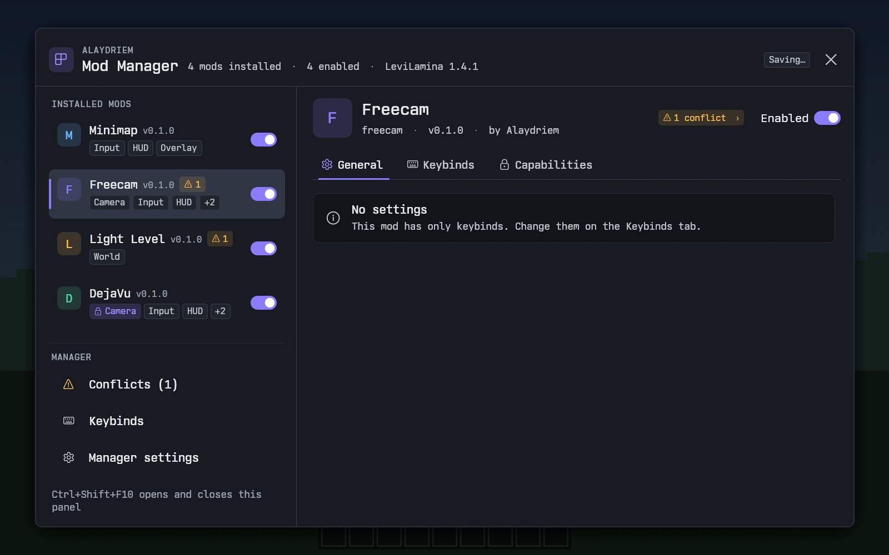
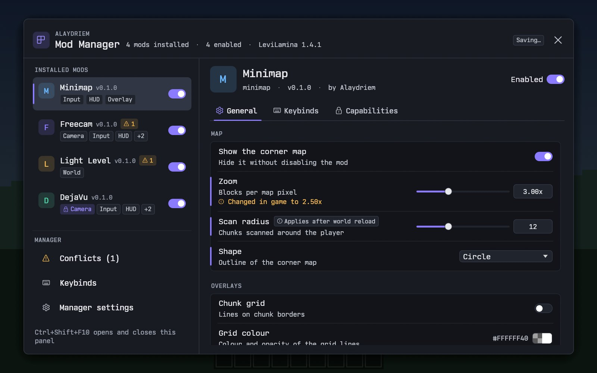
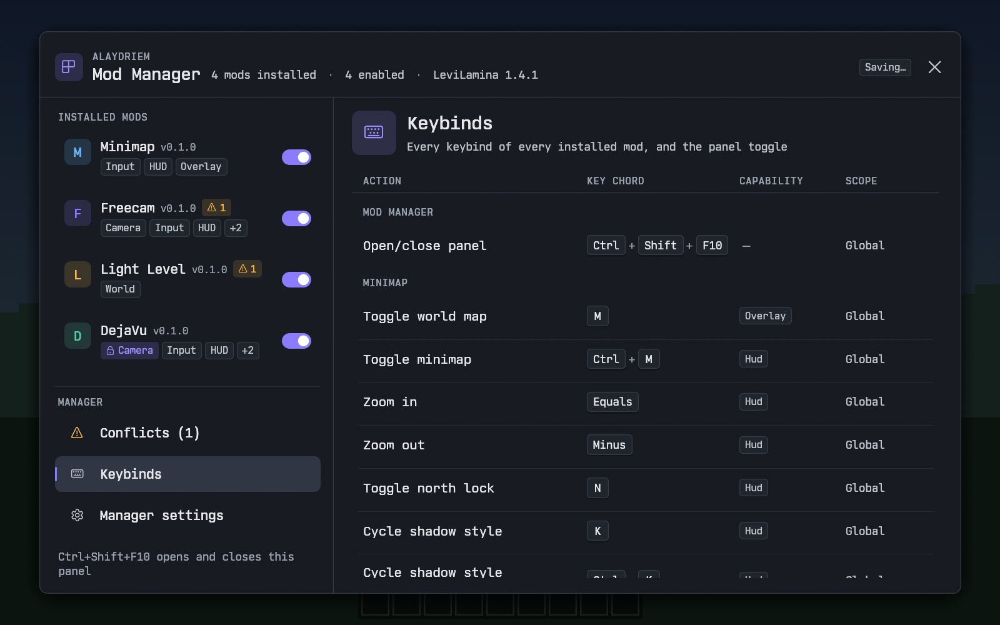
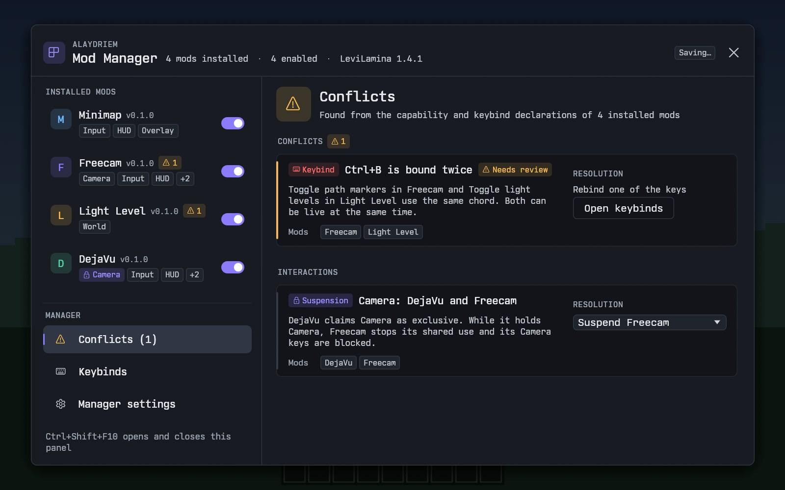
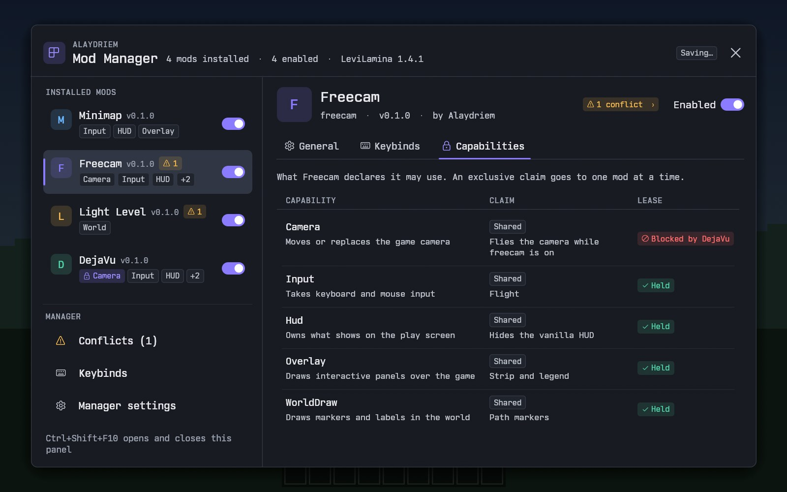
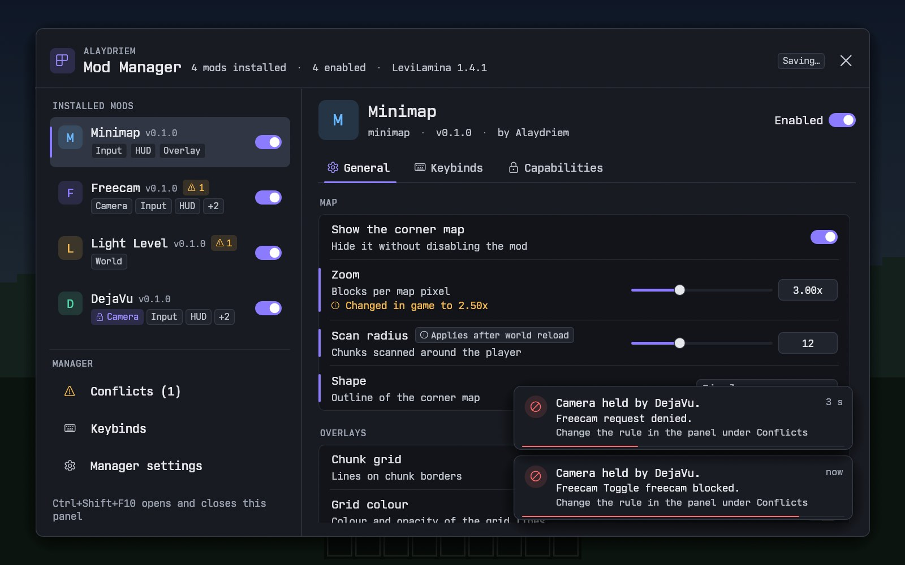
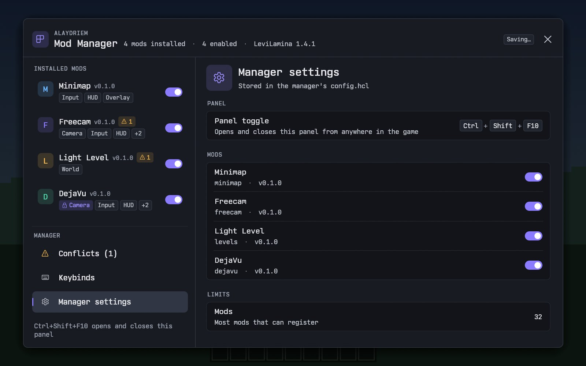
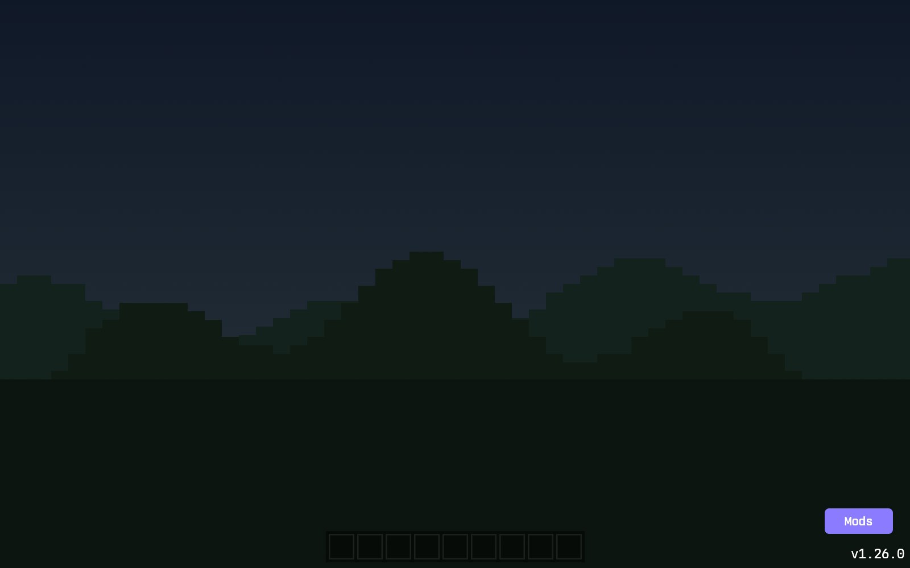

<div align="center">

# Alaydriem's Mod Manager

**One overlay, one set of keys and one settings panel for Alaydriem's LeviLamina mods.**

[](https://github.com/alaydriem/levi-crates/releases)
[](https://github.com/alaydriem/levi-crates/actions/workflows/ci.yml)
[](./LICENSE)

[](https://github.com/LiteLDev/LeviLamina)


[Install](#-installation) · [Using the panel](#-using-the-panel) · [Controls](#%EF%B8%8F-controls) · [Configuration](#%EF%B8%8F-configuration) · [For mod authors](#-for-mod-authors) · [FAQ](#-faq) · [Build](#%EF%B8%8F-building-from-source)

</div>

Alaydriem's Mod Manager is the mod that the other Alaydriem mods connect to. It draws the one overlay that all of them share, and it sends each key and mouse event to the correct mod. When two mods want the camera, the input, the HUD or the overlay at the same time, the manager decides which mod gets it, and a message tells you why. One panel shows every installed mod, with its settings, its keys and its conflicts.

> [!NOTE]
> This is a **client-side** mod. The other Alaydriem mods need it: each one lists `alaydriem-mod-manager` as a dependency in its `manifest.json`. Install the manager before you install them.

---

## ✨ Features

- **📋 Mod list**
  - Every installed mod, with its version, the capabilities it uses and a conflict badge.
  - An on/off switch for each mod. A disabled mod stops all its work. It comes back when you turn it on again.
- **⚙️ Settings for each mod**
  - Each mod's settings page is made from the list of settings that the mod gives. You get sliders, switches, lists, colours and keys, all in one style.
  - Each setting tells you when it takes effect: at once, after a world reload, or after a restart.
  - Changes save automatically, without a Save button. Comments that you write in a config file by hand stay in the file.
- **⌨️ One Keybinds page**
  - Every key of every mod in one table, grouped by mod.
  - Click a key to change it. Two mods that use the same key show a conflict until you change one of the keys.
- **🔒 Capabilities and conflicts**
  - Each mod declares what it can take: `Camera`, `Input`, `Hud`, `Overlay` or `WorldDraw`.
  - When one mod holds a capability, a request from a second mod is refused. A message names the mod that holds it.
  - A Conflicts page lists key clashes and capability clashes, with a choice of rule for each.
- **🖱️ Mods button**
  - A **Mods** button on the start screen and the pause screen opens the panel. You do not need a key.
- **📜 Logs**
  - One log file for each mod in each game session.
- **🎨 One theme**
  - All mods use the same "Studio Dark" theme and the Nordwand Mono font.

<table>
  <tr>
    <td align="center" width="50%"><br><sub>The mod list, with an on/off switch for each mod</sub></td>
    <td align="center" width="50%"><br><sub>A mod's settings, with "Applies after world reload" and "Applies after restart" labels</sub></td>
  </tr>
  <tr>
    <td align="center" width="50%"><br><sub>Every key of every mod on one page</sub></td>
    <td align="center" width="50%"><br><sub>A key clash and a camera interaction, each with its rule</sub></td>
  </tr>
  <tr>
    <td align="center" width="50%"><br><sub>What a mod can take, and what it holds now</sub></td>
    <td align="center" width="50%"><br><sub>A refused request names the mod that holds the camera</sub></td>
  </tr>
  <tr>
    <td align="center" width="50%"><br><sub>Manager settings</sub></td>
    <td align="center" width="50%"><br><sub>The Mods button, above the game version</sub></td>
  </tr>
</table>

<sub>Shown with example mods and sample settings.</sub>

---

## 📦 Installation

You need [LeviLamina](https://github.com/LiteLDev/LeviLamina) for the **client**, on a supported game version (see [Compatibility](#-compatibility)).

Install with [lip](https://github.com/LiteLDev/lip). Run this command in your game folder:

```powershell
lip install github.com/alaydriem/levi-crates#client
```

To remove the manager:

```powershell
lip uninstall github.com/alaydriem/levi-crates
```

<details>
<summary><b>Manual install</b></summary>

1. Download `alaydriem-mod-manager-<version>-client-windows-x64.zip` from the [latest release](https://github.com/alaydriem/levi-crates/releases/latest).
2. Extract it into your game's `mods` folder. The result must be `mods/alaydriem-mod-manager/alaydriem-mod-manager.dll`.
3. Start the game.

The folder name must stay `alaydriem-mod-manager`. LeviLamina does not load the mod from a folder with a different name, and the other mods find the manager by this name.

</details>

---

## ✅ Compatibility

| Manager version | Minecraft Bedrock (Windows) | LeviLamina |
| --- | --- | --- |
| 0.1.0 | 1.26.51 | 26.51.6 or later 26.51.x |

The manager hooks into the game directly. A new game version needs a new manager release. Each Alaydriem mod names the manager versions it accepts in its `manifest.json`, for example `>=0.1.0 <0.2.0`.

---

## 🧭 Using the panel

Open the panel in one of two ways:

- Click the **Mods** button at the bottom right of the start screen or the pause screen.
- Press <kbd>Ctrl</kbd> + <kbd>Shift</kbd> + <kbd>F10</kbd> anywhere in the game.

While the panel is open, it gets all the keyboard and mouse input, and the cursor is free.

The left column has two groups:

- **Installed mods.** Each mod, with its capabilities and its on/off switch. A warning badge shows the number of conflicts of that mod.
- **Manager.** **Conflicts** (with the number of open conflicts), **Keybinds** (every key of every mod) and **Manager settings** (the panel key, the on/off switch of each mod, and the mod limit).

Select a mod to see three tabs:

| Tab | What it shows |
| --- | --- |
| General | The mod's settings, in sections. A setting that applies later shows "Applies after world reload" or "Applies after restart". A value that the mod changed in the game while you edited it shows "Changed in game to …" |
| Keybinds | The mod's keys, with the capability and the scope of each key, and a clash marker |
| Capabilities | Each capability that the mod declares, its mode (`Shared` or `Exclusive`), the reason, and its state now (held, suspended, blocked or idle) |

Changes save automatically. The panel header shows the state: **Saving…** while a change waits, **Saved** for a short time after the change goes to the file writer, and **Save failed** when the writer refused the change.

---

## ⌨️ Controls

| Key | Action | When |
| --- | --- | --- |
| <kbd>Ctrl</kbd> + <kbd>Shift</kbd> + <kbd>F10</kbd> | Open or close the panel | Always |
| <kbd>Esc</kbd> | Close the panel | Panel open |
| Click a key in a Keybinds table | Start a rebind, then press the new key | Panel open |
| <kbd>Esc</kbd> | Cancel the rebind | Rebind waiting |
| Click **Mods** | Open the panel | Start screen or pause screen |

When you rebind a key, <kbd>Ctrl</kbd>, <kbd>Shift</kbd> and <kbd>Alt</kbd> only add to the preview. The first other key sets the new key, with the modifiers that you hold. To set a modifier alone (for example <kbd>Ctrl</kbd>), press and release it with no other key between.

> [!TIP]
> You can change the panel key on the Keybinds page (top row, "Open/close panel") or with `toggle_chord` in the manager's `config.hcl`.

---

## ⚙️ Configuration

The manager's config file is `mods/alaydriem-mod-manager/config/config.hcl`. The manager reads it when the game starts. If the file does not exist, the manager uses the defaults, and it writes the file when you change a setting in the panel. Comments, blank lines and the order of the file stay as you wrote them.

A key is written with the modifiers first, in the order Ctrl, Shift, Alt, joined by `+`. For example: `"Ctrl+Shift+F10"`, `"Alt+1"` or `"Ctrl"`.

The settings that most players change:

| Setting | Default | What it does |
| --- | --- | --- |
| `toggle_chord` | `"Ctrl+Shift+F10"` | The key that opens and closes the panel |
| `menu_button` | `true` | Show the Mods button on the start screen and the pause screen |
| `enabled { <mod id> = <bool> }` | every mod on | Turn a mod on or off. A mod that is not in the list is on |
| `log_level` | `"Info"` | Log level for every mod: `Error`, `Warn`, `Info`, `Debug` or `Trace` |
| `mod_log_levels { <mod id> = "<level>" }` | empty | Log level for one mod. It replaces `log_level` for that mod |
| `log_sessions_kept` | `20` | Log files kept for each mod. Older files are deleted when the game starts |

An example:

```hcl
toggle_chord = "Ctrl+Shift+F10"
menu_button  = true
log_level    = "Info"

enabled {
  alaydriem-demo = false
}

mod_log_levels {
  alaydriem-demo = "Debug"
}
```

Each mod's own settings are in the `config.hcl` in that mod's config folder. Change them in the panel. The manager is the only program that writes these files, and it keeps your comments. A mod config file that is not valid HCL is copied to `config.hcl.invalid` and replaced with the defaults.

<details>
<summary><b>Full reference</b></summary>

**Top level**

| Setting | Default | What it does |
| --- | --- | --- |
| `toggle_chord` | `"Ctrl+Shift+F10"` | The panel key |
| `menu_button` | `true` | Show the Mods button |
| `enabled` | empty | `<mod id> = true` or `false` for each mod |
| `log_level` | `"Info"` | Default log level. A name that is not known gives `Info` |
| `mod_log_levels` | empty | `<mod id> = "<level>"` for each mod |
| `log_sessions_kept` | `20` | Session log files kept for each mod |
| `telemetry` | `false` | Write performance counters to the manager log |
| `telemetry_interval_secs` | `10` | Seconds between two telemetry lines |
| `resolutions` | empty | The rules you pick on the Conflicts page. The panel writes them. `exclusive` takes `"DenySecond"` or `"Prefer:<mod id>"`. `suspension` takes `"Suspend"` or `"Coexist"` |

**`budgets`**

These limits keep the manager's memory and work bounded. A value out of range is changed to the nearest allowed value, and the manager log shows a warning with the setting name.

| Setting | Default | Allowed range | What it limits |
| --- | --- | --- | --- |
| `max_mods` | `32` | 1 to 32 | Mods that can register |
| `event_queue` | `256` | 16 to 4096 | Events that wait for one mod |
| `toasts` | `8` | 1 to 64 | Messages on the screen at one time |
| `toast_rate_ms` | `2000` | 0 to 60000 | Minimum time between two "held by" messages for the same capability and mod |
| `texture_bytes_per_mod` | `67108864` (64 MiB) | 0 to 1073741824 (1024 MiB) | Texture memory of one mod that does not ask for a texture budget |
| `vertices_per_mod` | `262144` | 0 to 1048576 | Vertices that one mod draws in one frame |
| `indices_per_mod` | `786432` | 0 to 3145728 | Indices that one mod draws in one frame |
| `draw_cmds_per_mod` | `16384` | 0 to 65536 | Draw commands of one mod in one frame |
| `upload_bytes_per_frame` | `16777216` (16 MiB) | 0 to 67108864 (64 MiB) | Texture bytes that one mod uploads in one frame |
| `freed_ids_per_frame` | `4096` | 0 to 16384 | Texture ids that one mod frees in one frame |
| `texture_deltas_per_frame` | `256` | 1 to 4096 | Texture changes that one mod sends in one frame |
| `textures_per_mod` | `1024` | 1 to 4096 | Textures that one mod keeps, when it does not ask for a texture budget |
| `max_texture_bytes_per_mod` | `1073741824` (1024 MiB) | 0 to 2147483648 (2048 MiB) | The most texture memory that one mod gets when it asks for a texture budget |
| `max_textures_per_mod` | `4096` | 1 to 8128 | The most textures that one mod gets when it asks for a texture budget. All mods share the 8128 texture slots, so a grant is a limit, not reserved space |
| `io_queue` | `32` | 1 to 256 | Config file writes and screenshots that wait. They share the queue; a full queue fails a screenshot |
| `write_merge_ms` | `500` | 0 to 10000 | Time after the last change before a save |
| `frame_failure_limit` | `30` | 1 to 1000 | Failed frames in a row before the manager stops drawing a mod |
| `max_keybinds` | `128` | 0 to 512 | Keys that one mod can declare |
| `max_fields` | `256` | 0 to 1024 | Settings that one mod can declare |

A mod that goes over a draw limit in a frame is drawn without its shapes for that frame. A texture change over a texture limit is refused. Turn the mod off and on again in the panel to reset its failed-frame count.

</details>

---

## 📜 Logs

Each mod writes one log file for each game session:

```text
<game>/logs/amm/<mod id>/<stamp>.log
```

`<game>` is the folder that holds LeviLamina's `logs` folder. The stamp is the time the manager started, for example `2026-10-20_13-05-22-123.log`, so the files of one session have the same name. The manager's own log is in `logs/amm/alaydriem-mod-manager/`. Each mod keeps its last 20 files (`log_sessions_kept`). Warnings and errors also show in the LeviLamina console.

---

## 🧩 For mod authors

A mod connects to the manager in four steps. [`examples/demo-mod/`](./examples/demo-mod/) is a complete mod that does all of them, and is the reference to copy from. The generated header [`include/alaydriem_mod_manager.h`](./include/alaydriem_mod_manager.h) documents every table function.

1. **Add the dependency** to your `manifest.json`:

   ```json
   "dependencies": [
     { "name": "alaydriem-mod-manager", "version": ">=0.1.0 <0.2.0" }
   ]
   ```

2. **Write a `descriptor.hcl`** with your mod's identity, claims, keys and settings, and embed it with `include_str!`. A short part of the demo's descriptor:

   ```hcl
   id           = "alaydriem-demo"
   display_name = "Demo"
   version      = "0.1.0"
   author       = "Alaydriem"
   config_path  = "config.hcl"

   claim "Hud" {
     mode   = "Shared"
     reason = "Shows the demo card"
   }

   keybind "toggle_card" {
     label       = "Toggle card"
     default     = "Alt+1"
     capability  = "Hud"
     scope       = "Global"
     config_path = "keys.toggle_card"
   }

   section "card" {
     title = "Card"
     field "card.opacity" {
       label   = "Opacity"
       kind    = { float = { min = 0.0, max = 1.0, step = 0.05 } }
       default = 0.9
       apply   = "Live"
     }
   }
   ```

   Each keybind's `config_path` must point at a field of kind `chord` (the demo has them in its `keys` section).

   A mod that needs more texture memory than the default (64 MiB in 1024 textures) asks for it at the top level of its descriptor, for example `texture_budget_mb = 512` and `texture_budget_count = 2200`. Each value must be a whole number of 1 or more. The manager gives the smaller of the request and its `max_texture_bytes_per_mod` and `max_textures_per_mod`. A texture upload past the grant is refused, so the mod must keep inside it.

3. **Connect with `amm-client`.** `ApiTable::resolve()` finds the manager's table. `ManagerLink::new(table, descriptor, config_dir, handler)` registers a mod that draws with egui through a `FrameHandler`. `ManagerLink::without_frame(table, descriptor, config_dir)` registers a mod that draws nothing. Without egui, set `default-features = false` to remove the `egui` feature. Then call `acquire` and `release` for each capability, and read your events each game tick. A mod that holds an active `Hud` or `Overlay` lease can save a picture of the game (without the manager's layers) with `request_screenshot(path)`; the events `ScreenshotTaken` and `ScreenshotWritten` report the result.

4. **Use `studio-ui`** for the Studio Dark theme and widgets, so your mod looks like the panel.

For tests, the `test-support` feature of `amm-client` gives `amm_client::test_support::FakeTable`: a fake manager that queues events, sets the config text and the acquire outcome, and records each call. Run these tests with `cargo nextest`.

<details>
<summary><b>The crates, and C++ mods</b></summary>

| Crate | Owns |
| --- | --- |
| `studio-ui` | The Studio Dark theme: palette, metrics, Nordwand Mono, widgets |
| `amm-core` | Every shared type, plus the registry, descriptor checks, clashes, leases, keybind matching, input routing decisions and settings checks. No game, OS or GPU code |
| `amm-abi` | The `#[repr(C)]` types and the function table |
| `amm-store` | The I/O thread that writes `config.hcl` files, and the per-session log files |
| `amm-ui` | The manager panel, built on `studio-ui` |
| `amm-ffi` | The manager's C interface |
| `amm-client` | The library that client mods use |

A C++ mod uses the generated header [`include/alaydriem_mod_manager.h`](./include/alaydriem_mod_manager.h). It gets the table with `GetModuleHandleW(L"alaydriem-mod-manager.dll")` and `GetProcAddress` on `amm_get_api`, and logs through the table's `log` function.

</details>

---

## ❓ FAQ

<details>
<summary><b>The panel does not open with the keys.</b></summary>

Another program can take a key combination for the whole system before the game gets it. The Mods button on the start screen and the pause screen always opens the panel. Then change the panel key on the Keybinds page, or set `toggle_chord` in the manager's `config.hcl` (see [Configuration](#%EF%B8%8F-configuration)).

</details>

<details>
<summary><b>A mod shows a conflict.</b></summary>

Open **Conflicts** in the panel. A key clash means that two mods use the same key: click **Open keybinds** and change one of the keys. A capability clash means that two mods want the same capability for themselves: pick a rule. Interactions (one mod pauses another mod while it holds a capability) are expected, and show no badge.

</details>

<details>
<summary><b>A key does nothing.</b></summary>

Another mod can hold a capability that the key needs. Then the manager blocks the key, and a message at the bottom right names the mod that holds it, for example "Camera held by DejaVu". The key works again when that mod releases the capability. Also check that the mod is on in the panel.

</details>

<details>
<summary><b>The header shows "Save failed".</b></summary>

The manager could not write a config file. It tries again with your next change. The manager log names the file and the cause (see [Logs](#-logs)).

</details>

<details>
<summary><b>The mod does not load.</b></summary>

Check that LeviLamina is the **client** build for your game version (see [Compatibility](#-compatibility)), and that the folder is named exactly `mods/alaydriem-mod-manager/`. The LeviLamina log names the cause.

</details>

<details>
<summary><b>Can I remove the manager?</b></summary>

Only if you also remove the Alaydriem mods that need it. They do not work without it.

</details>

---

## 🛠️ Building from source

You need Windows 10 or 11 (x64) and [mise](https://mise.jdx.dev). mise installs the pinned versions of xmake and cbindgen. You also need Rust through rustup (the version is pinned in `rust-toolchain.toml`), [cargo-nextest](https://nexte.st), and LLVM with `clang-cl`.

```powershell
git clone https://github.com/alaydriem/levi-crates
cd levi-crates
mise trust
mise run preflight   # names a missing tool
mise run build-mod   # output: shim/bin/alaydriem-mod-manager/
mise run build-demo  # output: examples/demo-mod/shim/bin/alaydriem-demo/
mise run test        # every Rust test
mise run e2e         # end-to-end scenarios
```

<details>
<summary><b>How the code is organised</b></summary>

Nearly all the logic is in Rust, in the crates under `crates/` (see [For mod authors](#-for-mod-authors)). A thin C++ part in `shim/` connects to the game through LeviLamina: hooks, the Direct3D 11 overlay, the window procedure and the input listeners. It decides nothing, and asks Rust for every decision. `mise run header` makes the C header from `amm-abi`. Run `mise tasks` to see every build, test and bench task.

</details>

---

## 🔗 Related

These mods use the manager:

- [Alaydriem's Mini Map](https://github.com/alaydriem/levi-minimap): a minimap and full world map.
- [Alaydriem's Freecam](https://github.com/alaydriem/levi-freecam): a free camera with smooth motion and camera paths.
- [Alaydriem's Light Levels](https://github.com/alaydriem/levi-levels): a light-level overlay to find where mobs can spawn.
- [DejaVu](https://github.com/alaydriem/bedrock-protocol-rs): an in-game replay viewer for `.bpr` captures.

## 📄 License and credits

BSD 3-Clause. See [LICENSE](./LICENSE).

The [Nordwand Mono](https://github.com/tywr/Nordwand-Mono) font is under the SIL Open Font License 1.1. Its license text, `OFL.txt`, ships with the mod.

Thanks to [LeviLamina](https://github.com/LiteLDev/LeviLamina), [egui](https://github.com/emilk/egui), [Curia](https://github.com/charlesportwoodii/curia) and [hcl-rs](https://github.com/martinohmann/hcl-rs).
